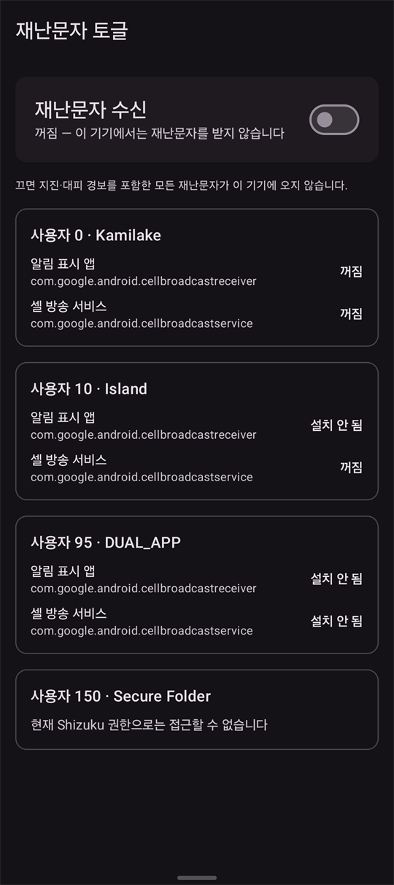
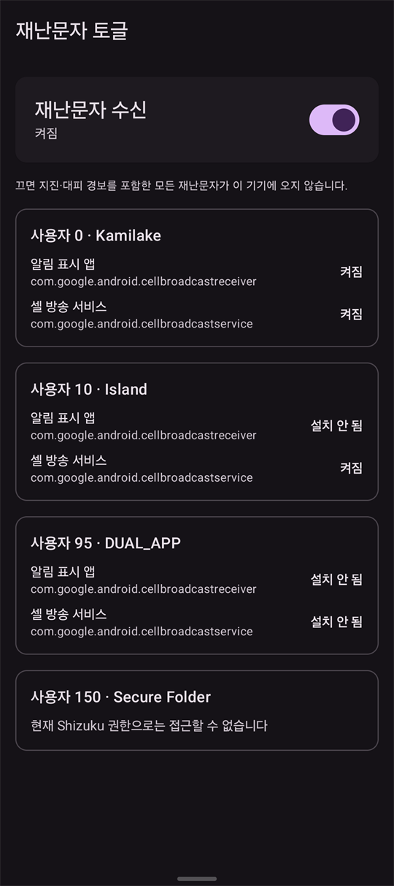
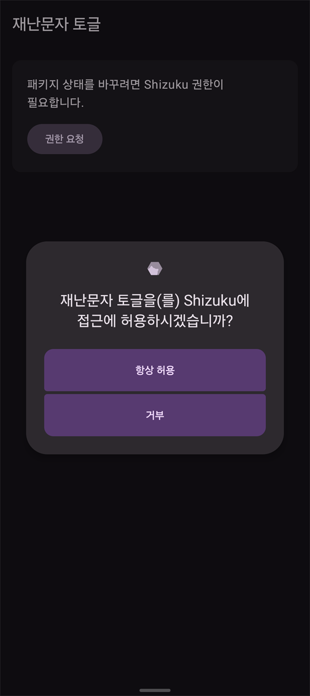
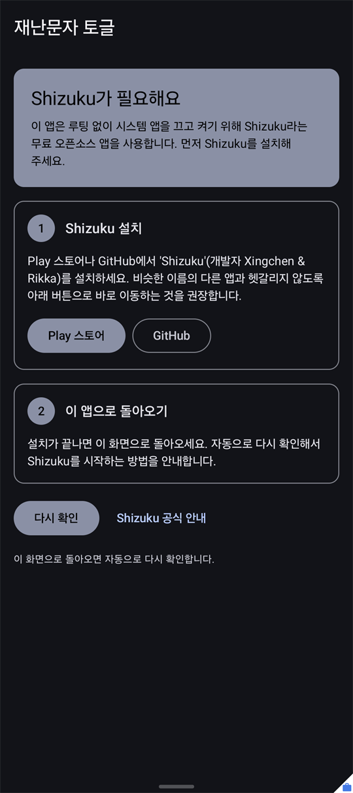
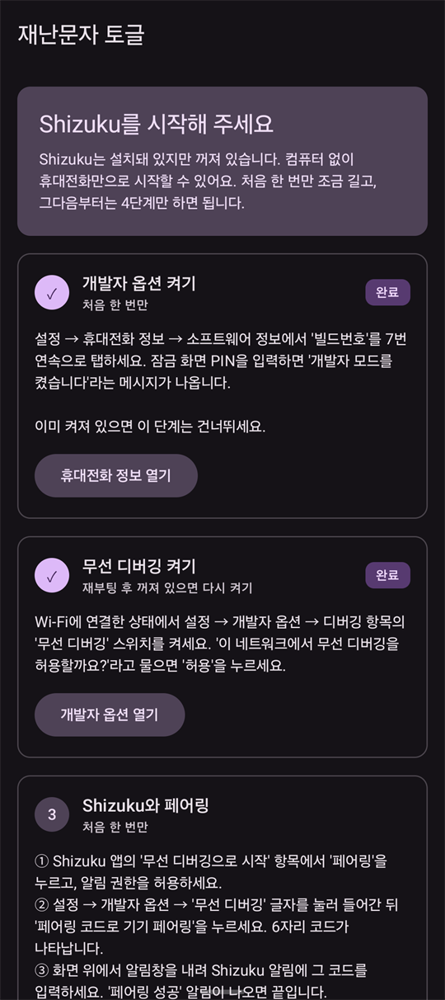
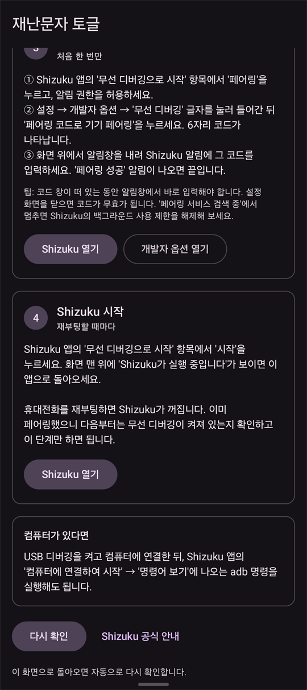

# 재난문자 토글 (Cell Broadcast Toggle)


[Shizuku](https://shizuku.rikka.app/)를 이용해 Android 기기의 **재난문자(셀 방송, Wireless Emergency Alerts) 수신을 스위치 하나로 끄고 켜는** 앱입니다.
루팅이 필요 없습니다.

진열용·개발용 기기처럼 **실제 경보를 다른 기기로 받고 있는** 휴대전화에서 불필요한 경보음을 없애기 위해 만들었습니다.

> [!WARNING]
> 끄면 지진·대피 경보를 포함한 **모든 재난문자가 그 기기에 오지 않습니다.**
> 평소 쓰는 휴대전화에서는 사용하지 마세요.

## 스크린샷

| 꺼짐 | 켜짐 | Shizuku 권한 요청 |
|:---:|:---:|:---:|
|  |  |  |

## 동작 방식

앱은 Shizuku의 셸 권한으로 아래 두 패키지를 **사용자(프로필)별로** 비활성화하거나 다시 활성화합니다.

| 패키지 | 역할 |
|---|---|
| `com.google.android.cellbroadcastreceiver` | 재난문자를 받아 알림으로 표시하는 앱 |
| `com.google.android.cellbroadcastservice` | 셀 방송 메시지를 처리하는 서비스 모듈 |

내부적으로 실행하는 명령은 adb에서 직접 입력하는 것과 같습니다.

```powershell
# 끄기
adb shell pm disable-user --user 0 com.google.android.cellbroadcastreceiver
adb shell pm disable-user --user 0 com.google.android.cellbroadcastservice

# 다시 켜기
adb shell pm enable --user 0 com.google.android.cellbroadcastreceiver
adb shell pm enable --user 0 com.google.android.cellbroadcastservice
```

- 기기에 있는 사용자(기본, 듀얼 앱, 업무 프로필 등)를 모두 찾아서, 설치된 패키지에만 적용합니다.
- 비활성화 상태는 재부팅 후에도 유지됩니다. Shizuku는 스위치를 바꿀 때만 필요합니다.
- 패키지를 삭제하지 않으므로 언제든 같은 스위치로 되돌릴 수 있습니다.
- 설정 오버레이(`com.google.android.overlay.modules.*`)는 건드리지 않습니다.

## 요구 사항

- Android 12 이상 (Material You 동적 색상 사용)
- [Shizuku](https://shizuku.rikka.app/) 설치 및 실행
  - 무선 디버깅으로 시작하면 컴퓨터 없이도 됩니다. Shizuku가 설치되지 않았거나 꺼져 있으면 앱이 단계별로 안내합니다.

## Shizuku 안내 화면

Shizuku가 없거나 꺼져 있으면 앱이 상황에 맞는 안내를 보여 줍니다. 다른 앱에서 작업을 마치고 돌아오면 자동으로 다시 확인합니다.

| Shizuku 미설치 | Shizuku 꺼짐 (1/2) | Shizuku 꺼짐 (2/2) |
|:---:|:---:|:---:|
|  |  |  |

- **미설치**: Play 스토어와 GitHub 공식 배포 페이지로 바로 이동하는 버튼을 제공합니다.
- **꺼짐**: 개발자 옵션 → 무선 디버깅 → 페어링 → 시작 순서로 안내합니다. 개발자 옵션과 무선 디버깅이 이미 켜져 있으면 "완료"로 표시합니다.
- **권한 거부**: Shizuku 앱의 '인증된 앱'에서 다시 허용하도록 안내합니다.

검증한 기기: Galaxy Z Fold Special Edition (SM-F958N), Android 15

## 알려진 제한

- **보안 폴더**처럼 셸 권한으로 접근할 수 없는 프로필은 바꿀 수 없습니다. 앱에 "접근할 수 없음"으로 표시됩니다.
- 패키지 이름은 Google 셀 방송 모듈 기준입니다. 제조사가 다른 패키지를 쓰는 기기에서는 "패키지를 찾지 못했습니다"로 표시됩니다.
- 시스템 업데이트 뒤에는 상태가 유지됐는지 앱에서 한 번 확인하는 것을 권장합니다.

## 빌드

JDK 21과 Android SDK(compileSdk 36.1)가 필요합니다.

```powershell
./gradlew assembleDebug
adb install --user 0 app/build/outputs/apk/debug/app-debug.apk
```

`--user 0`을 빼면 듀얼 앱·업무 프로필 등 모든 사용자에게 설치됩니다.

## 라이선스

[MIT](LICENSE)

앱 아이콘은 Android Open Source Project의 CellBroadcastReceiver 아이콘(Apache License 2.0)을 사용했습니다. 자세한 내용은 [NOTICE](NOTICE)를 참고하세요.
